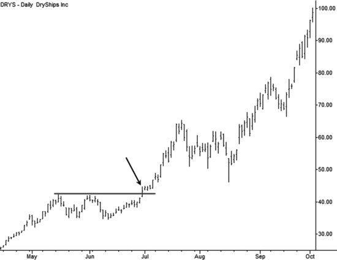
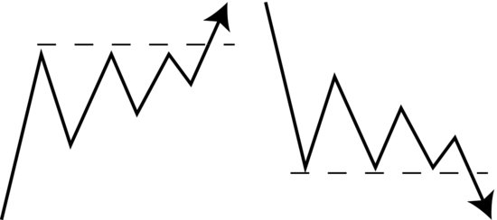
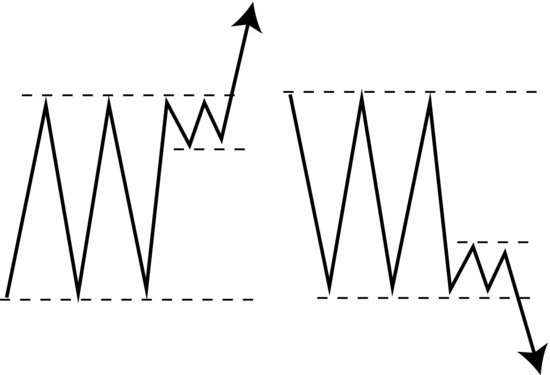
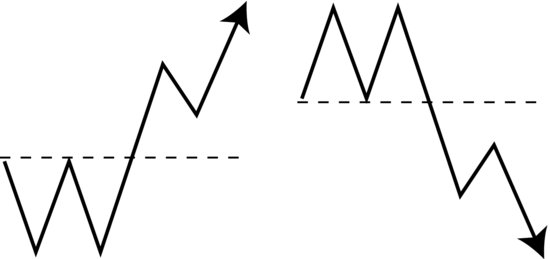
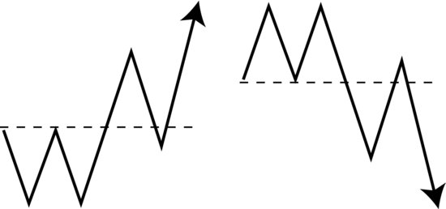
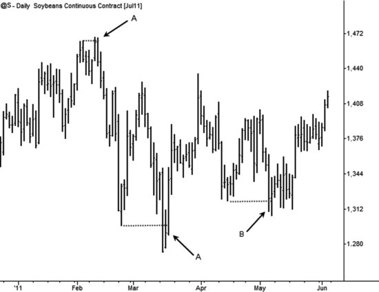
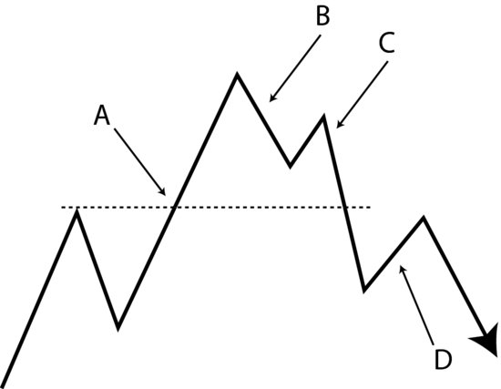
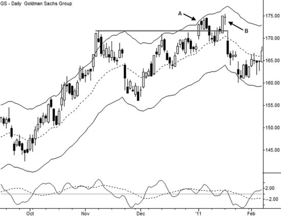

+++
title = "Adam Grimes 如何交易突破"
heading = "Adam Grimes 如何交易突破：真正要交易的不是越线，而是失衡"
deck = "从突破前的压力积累、突破时的失衡，到第一次回调与失败突破，系统梳理 Adam Grimes 的突破交易框架。"
summary = "以 Adam Grimes 的结构框架理解突破前准备、突破确认、第一次回调、失败突破与风险管理。"
eyebrow = "交易研究 · Adam Grimes"
subtitle = "压力积累、真实失衡与风险边界"
published_on = "2026-08-24"
tags = ["Adam Grimes", "突破交易", "价格行为", "趋势交易", "风险管理"]
status = "published"
+++

Adam Grimes 如何交易突破：真正要交易的不是越线，而是失衡

突破看起来是最容易理解的交易形态：价格越过阻力就买入，跌破支撑就做空。

但真正交易过突破的人，很快会发现完全不同的现实。价格刚刚越线就回到区间，止损之后再次突破；一次看似强劲的上冲，最后变成高位诱多；另一次平淡无奇的穿越，却启动了持续数周的趋势。

Adam Grimes 对这个问题的回答是：**不要把突破理解成价格穿过一条线，而要把它理解成市场从均衡状态转向失衡状态。**

因此，突破交易真正要回答三个问题：突破之前，压力是否已经积累？突破发生时，是否出现了真实订单流？突破之后，第一次回调是在确认新趋势，还是暴露一次失败？

本文依据《技术分析的艺术与科学》第5、6、8章及《交易课程工作手册》第7模块，结合原书示意图和案例，完整拆解 Adam 的突破交易框架。

## 一、突破交易的矛盾：大趋势离不开突破，但多数突破都会失败

如果市场要上涨，它最终必须突破前期高点；如果市场要下跌，也必然要跌破前期低点。只要持续参与突破，交易者就有机会抓住真正的大趋势。

图5.1中的 DRYS 是最容易让人对突破着迷的案例：价格离开一段持续整理后，几乎没有给迟到者舒服的回调，随后启动一轮幅度巨大的上涨。



*图5.1　DRYS 在2007年夏季的突破交易。图源：Adam Grimes，《技术分析的艺术与科学》。*

但 Adam 紧接着给出警告：**大多数突破都会失败。**

区间外通常聚集着原有仓位的止损、追突破的新订单，以及等待流动性的大资金。价格很容易被这批订单暂时推过边界；一旦止损触发完毕，如果没有新的持续买盘或卖盘，市场就会重新回到区间。

这并不意味着突破不能交易。突破交易通常依靠的是非对称结果：许多受控小亏，换取少数能发展成新趋势的大盈利。真正的问题是不加筛选地追逐每一次越线——点差、滑点和连续失败足以把这种微弱优势消耗殆尽。

所以 Adam 的突破方法不是寻找更多信号，而是严格区分：**哪些越线反映真实失衡，哪些只是区间边缘的噪声。**

## 二、良好突破在发生之前，通常已经留下线索

好的突破很少只靠某一根神奇K线完成。大资金的仓位很难在突破瞬间一次建完，往往需要提前在区间内吸筹或派发。虽然交易者看不到真实订单，大资金的行为却可能通过摆动结构留下痕迹。

### 1. 向关键价位推进时，逆向摆动不断缩短

图5.2左侧展示了典型的向上突破准备：阻力没有变化，但每一次下跌都比前一次更浅，低点逐步抬高。右侧是完全对称的向下突破结构。



*图5.2　向关键价位推进时摆动逐步缩短。图源：Adam Grimes，《技术分析的艺术与科学》。*

低点抬高并不是因为“三角形天然看涨”，而是因为买方越来越急迫：他们不再等待价格回到区间底部，而是在更高位置接货。做空者能够取得的下跌空间越来越小，压力最终集中到阻力附近。

下降结构反过来理解：反弹越来越浅、高点不断降低，说明卖方愿意以越来越低的价格卖出。

### 2. 大区间边缘出现一个更小的窄幅区间

图5.3展示了第二类高质量背景：市场原本在大型区间内振荡，后来却停留在区间边缘，形成高度明显小于大区间的窄幅整理。



*图5.3　大型区间边缘的窄幅整理，常出现在良好突破之前。图源：Adam Grimes，《技术分析的艺术与科学》。*

Adam 给出的经验观察是，小区间高度通常不到大区间的四分之一。重点不在精确比例，而在行为含义：市场本应自然回到大区间中部，却被持续压在边缘，说明一方不愿让价格回归均值。

向上突破前，这种结构也可称为“突破底部”；向下突破前，则可以理解为边缘处的派发区。

### 3. 价位必须重要，而且应该被大多数参与者看见

真正有价值的突破位通常经过多次清晰测试。它的重要性不是来自画线技巧，而是因为大量交易者会在该位置作出决定：止损、获利了结、追突破或反向建仓都会创造额外订单流。

这也解释了为什么 Adam 不把任意20日或55日新高视为同等重要的主观突破机会。通道系统可以依靠完整的系统规则捕捉趋势，但短周期波段突破需要更具体的结构背景。一个在图上没有明显意义的机械新高，不一定会形成足以推动趋势的订单失衡。

## 三、真正的突破应该是一个“事件”

良好突破由异常订单流驱动，因此通常具有三个共同特征。

第一，**波幅扩张**。突破K线或较低时间框架的K线，应该明显大于此前整理阶段。温和、礼貌地穿过重要价位，往往不符合真实失衡应有的表现。

第二，**活跃度和参与增加**。在有可靠成交量的市场，可以观察成交量；在其他市场，则更应关注波幅、运行速度和价格接受程度。指标不是关键，关键是突破点确实出现了不同于此前区间的行为。

第三，**很快得到方向性反馈**。日内突破可能在几秒或几分钟内显示结果，周线突破可能需要几天。即时反馈不等于价格只许直线前进，而是说市场不应在突破后毫无生气地反向慢磨。

突破交易还有一个反直觉特征：适度的不利滑点可能是健康现象。如果市场正在快速失衡，想买入的人本来就可能被迫支付更高价格。相反，如果你准备在50.00上方买入，却轻松得到49.98的成交，未必值得高兴——有人非常愿意把仓位卖给你，说明反向供给可能比预期更强。

不过，滑点不是越大越好。它首先是风险和成本，尤其在新闻、跳空、流动性不足或单根K线内部波动剧烈时，实际亏损可能超过计划止损。工作手册因此要求交易者在回测前就明确：怎样定义突破位、使用什么突破前过滤条件，以及究竟用挂单、盘中确认还是收盘执行。

## 四、三种入场方法：提前布局、突破入场、第一次回调

Adam 把突破交易拆成三个可能的入场阶段。三者没有绝对优劣，只是在价格、确认和执行难度之间做不同交换。

### 方法一：在突破前的小型底部内建仓

提前入场能避开突破点最剧烈的波动，并取得更好的回报风险比。多头可以考虑三种执行方式：在小区间下沿挂限价单；等待价格短暂跌破下沿后迅速收回，再顺短期动量买入；或者确认结构后直接在底部内建立仓位。

它的缺点是突破尚未发生。市场可能继续整理，也可能朝相反方向离开。止损可以放在小型底部最低点之外；如果采用更宽的最终止损，也应在价格开始持续接受更低价位时主动退出。

限价单还存在逆选择：它能改善成交价格，却可能错过那些不再回调、直接启动的最佳突破；与此同时，只要市场跌到你的限价后继续下行，亏损交易仍会完整成交。

### 方法二：在价格实际突破时入场

交易者可以使用突破止损单、看到突破后市价入场，或者等待突破K线收盘。这样做确认最多，却要承受最差的流动性、滑点和跳空风险。

这种方法适合执行能力较强的短线交易者，也适合必须参与每一个潜在趋势开端的系统化方法。主观交易者如果无法清楚区分重要价位与普通价位，很容易在大量低质量突破中被连续小亏消耗。

### 方法三：等待突破后的第一次回调

对多数主观交易者而言，这是结构最清楚的做法。前提是重要价位已经被有效突破，并且价位之外出现了足够的波动、活跃度和方向性；最初推动结束后，再把第一次回调当作标准趋势回调处理。

图5.4是最理想的情况：价格突破后形成清楚推动，第一次回调完全守在突破位之外，随后趋势继续。



*图5.4　第一次回调守在突破价位之外。图源：Adam Grimes，《技术分析的艺术与科学》。*

入场触发可以是低一级时间框架逆势趋势被突破、一次失败测试，或回调中的小型整理顺突破方向离开。止损则使用标准回调止损，放在真正否定趋势假设的位置。

## 五、最危险的误读：回到突破线以内，不等于突破失败

许多交易者默认：阻力突破后必须立刻变成支撑，价格只要回到突破线下方，突破就已经失败。

图5.5明确否定了这种机械理解。良好突破后的第一次回调，完全可能穿回突破价位，清洗追突破的弱手后再恢复趋势。



*图5.5　回调穿回突破价位，仍可能恢复原突破方向。图源：Adam Grimes，《技术分析的艺术与科学》。*

大资金未必愿意精确防守一条图表线。他们可能乐于在更低价格继续吸收短线交易者的止损卖盘。当弱手退出、卖压枯竭后，市场反而可能获得第二次推动。

因此，突破线通常不适合作为机械保本位。更合理的结构参考包括第一次回调的极端点、突破前底部的关键枢轴，以及能够真正证明新趋势假设错误的位置。

但这不等于无限度容忍回撤。如果简单突破回调进一步破坏突破前底部的关键枢轴，并在原区间内持续形成价格接受，继续持有的理由就已经很弱。关键不是“碰线”，而是市场是否已经重新建立与突破方向相反的信念。

## 六、失败突破：真正的触发不是穿线，而是“失败回调”

Adam 把短暂越过关键价位、价位外没有延续、随后迅速反转的行为称为失败测试。高质量失败测试的共同点，是价格越过关键价位后很快失去延续，并以明显反向动量收回该价位；在具体时间框架上，“很快”必须由预先测试的规则界定，而不能机械套用两三根K线。

图5.6中的A点展示了两个清楚的失败测试：价格刺破可见价位后迅速被打回。B点虽然也越过了低点，却在附近花费更多时间，更像跌破后的延续，而不是高质量失败测试。



*图5.6　A点是较好的失败突破，B点更像跌破后的延续。图源：Adam Grimes，《技术分析的艺术与科学》。*

判断失败突破，应综合观察：突破时是否缺乏动量；第一次反应是否轻易吞没大部分突破冲击；价格是否在前高或前低形成失败测试；以及是否出现足以破坏首次回调的逆向推动。

这里最重要的执行规则是：**不要刚穿回突破线就机械反手。**实际可交易的失败突破，本质上是突破之后的回调发生了失败。一个更清楚、但会牺牲部分交易位置的执行路径是：先等待强劲逆向推动确认，再在其后的反向回调中寻找入场；具体触发仍须由交易计划和回测定义。

图5.8展示了完整路径：A是原突破位，B是突破后的正常回调；C处价格从回调错误一侧强劲跌破，确认向上突破失败；D处出现反弹回调，才提供更有结构依据的做空位置。



*图5.8　C处确认突破回调失败，D处的回调才是更清楚的逆向机会。图源：Adam Grimes，《技术分析的艺术与科学》。*

GS 的案例把同一逻辑放进了实盘环境。A处向上突破的动量和信念不足，随后的回调吃掉大部分突破幅度；B处再次测试前高失败，才让向上突破失败的证据更加完整。



*图6.21　GS 中的一次向上突破失败尝试。图源：Adam Grimes，《技术分析的艺术与科学》。*

失败突破交易伴随显著尾部风险。止损应放在初始失败冲击的极端之外，一旦触发就直接退出；不能围绕止损反复交易，更不能向亏损仓位摊低成本。你也许能多次侥幸逃脱，但一次真正趋势突破就可能抹去此前许多利润。

## 七、风险和退出：先定义1R，再保留新趋势的可能

Adam 的风险管理顺序是先寻找能够证明交易错误的位置，再根据止损距离计算仓位：

```text
仓位规模 = 单笔允许承担的金额风险 ÷ 入场价到结构止损的距离
```

主书第8章给出的粗略指导是：初始止损距离少于约2 ATR的情况较少，有时甚至会超过4 ATR。但这不是突破专用公式，更不是所有市场都必须使用的固定参数。它要表达的是：止损必须越过正常噪声，同时仍与关键枢轴和形态失效位置一致。止损更宽，仓位就必须更小。

盈利管理上，Adam 通常在价格达到大约1R时兑现一部分仓位，再让剩余仓位参与潜在新趋势。突破前的波动率通常经过压缩，用整理高度计算出的固定量度目标可能过于保守；如果第一次确认性回调成功，剩余仓位就可以按普通趋势交易管理，在后续拐点继续部分止盈或移动保护止损。

失败突破的逆向交易则应更积极兑现第一段利润，因为失败既可能引发恐慌性大运动，也可能重新被吸收到更大的交易区间。两种结果都必须预先写进计划。

## 八、把 Adam 的突破方法变成一张决策清单

每次考虑突破交易时，可以依次回答以下问题：

1. 这是不是经过多次测试、所有参与者都能看见的重要价位？
2. 突破前有没有低点抬高、高点降低、边缘窄幅整理或弹簧/上冲失败？
3. 价格是在区间边缘积累压力，还是仍在区间中部随机振荡？
4. 突破时有没有波幅扩张、参与增加和符合时间框架的即时反馈？
5. 我的计划是突破前布局、突破时执行，还是等待第一次回调？
6. 哪个位置真正证明交易假设错误？仓位是否按这个止损计算？
7. 如果价格穿回突破线，但没有破坏关键枢轴，我是否会被机械洗出？
8. 如果出现反向强动量，我是退出，还是已经有等待失败回调确认的反手计划？
9. 到达1R后减多少仓位，剩余仓位如何参与可能的新趋势？
10. 回测是否纳入点差、滑点、跳空、新闻和单根K线内部波动？

Adam 的突破方法最终可以浓缩成一句话：

> 不交易“越线”本身，而是交易越线前的压力、越线时的扩张，以及第一次回调揭示的真实信念。

这套框架不会消除失败突破，也不承诺高胜率。它的价值在于让交易者从“看到形态就追价”，转向观察市场状态、提前定义失效，并用少数大趋势覆盖一系列受控亏损。

---

**资料来源**

- Adam Grimes，《The Art and Science of Technical Analysis》，重点参考第5、6、8章。
- Adam Grimes，《The Art and Science of Trading Course Workbook》，重点参考第7模块。

文中原书图示用于交易方法评论与学习说明，图号和图注沿用当前中文审核版。本文不构成投资建议；具体参数必须结合市场、时间框架、交易成本和大样本回测独立验证。
