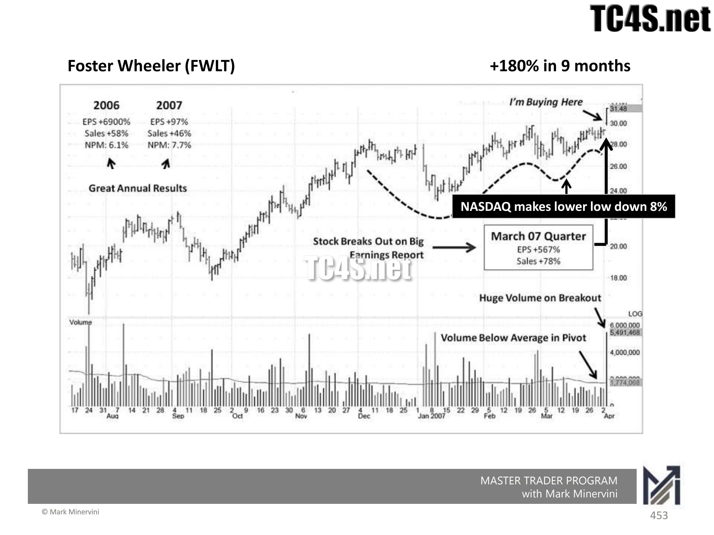
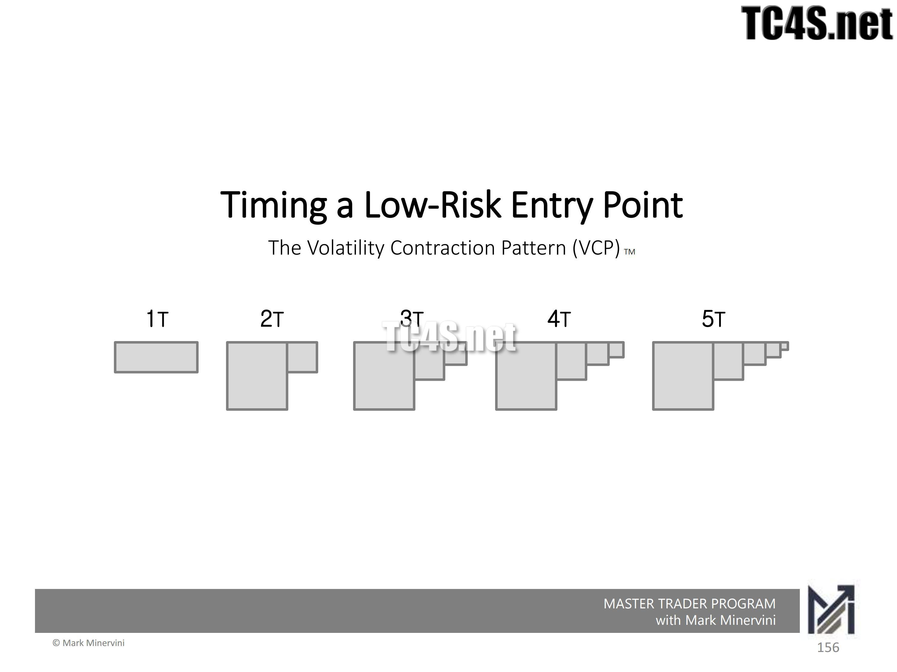
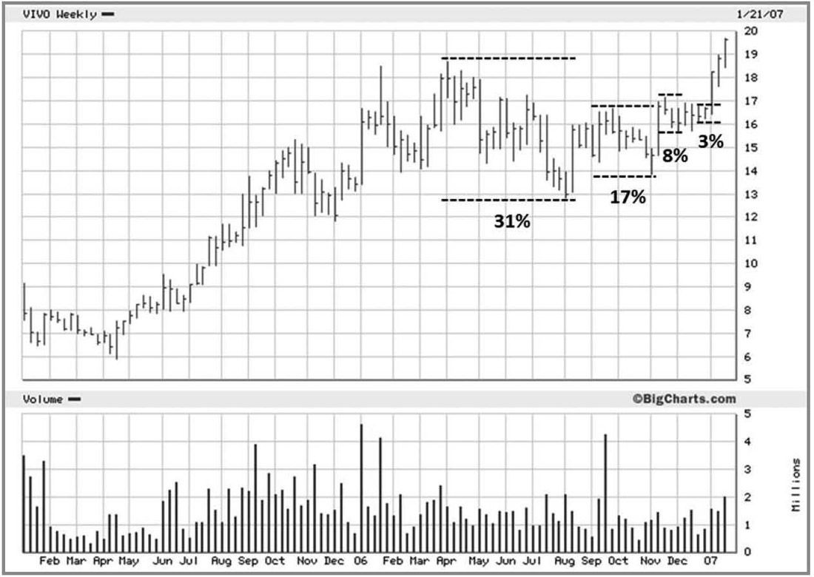
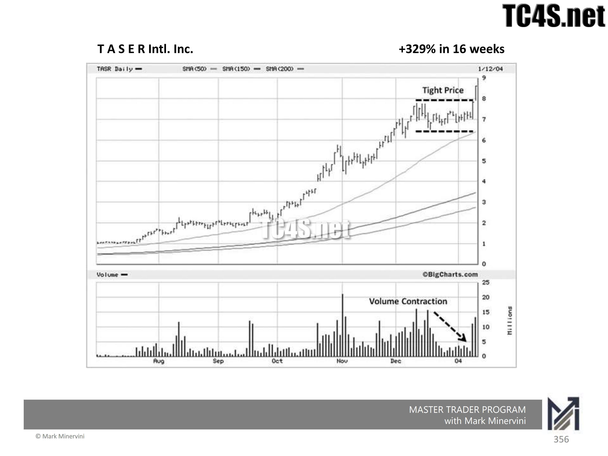
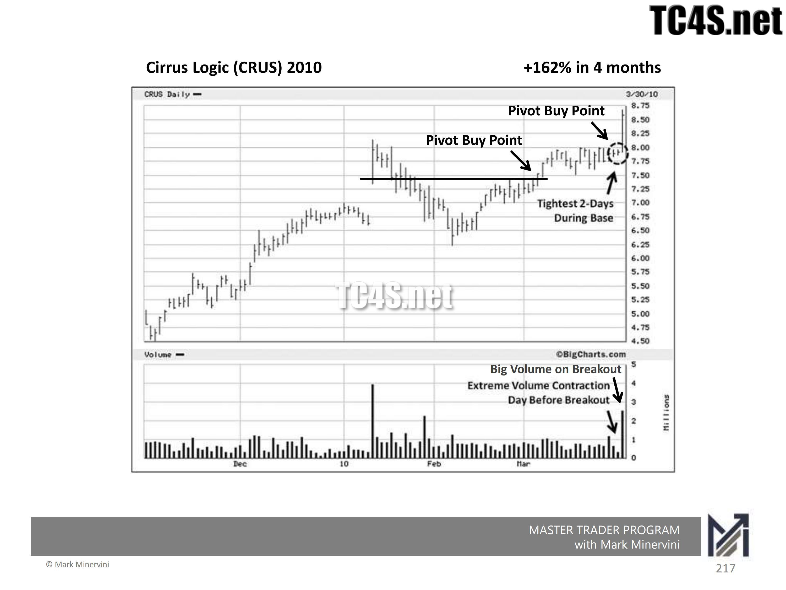
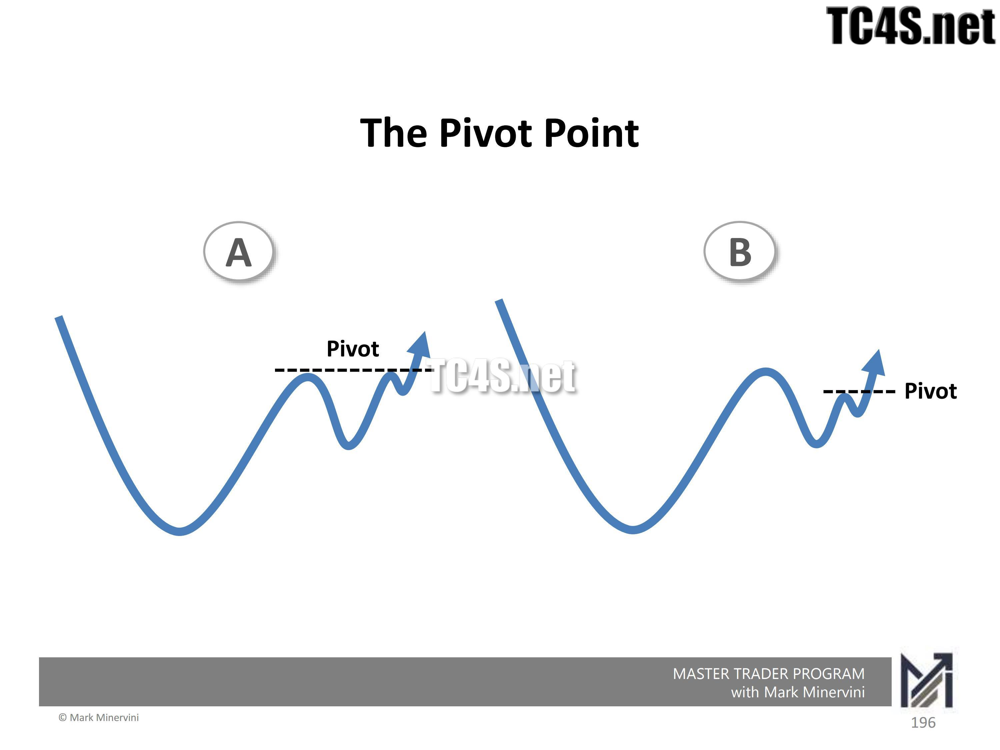
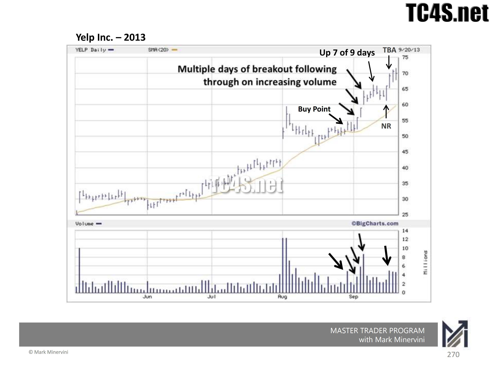
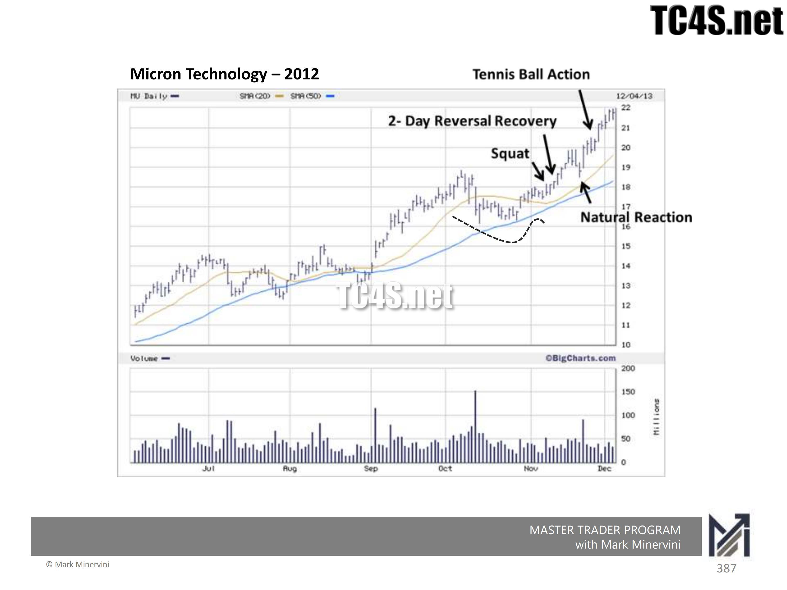
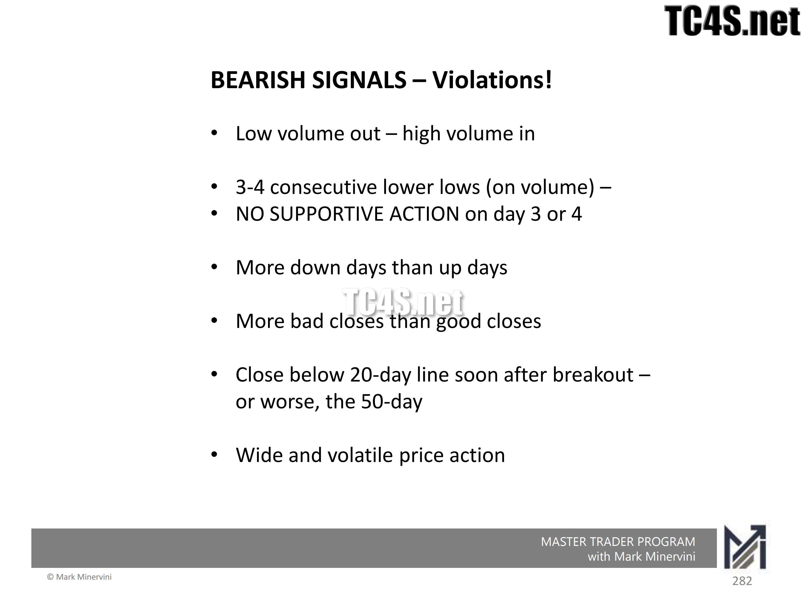

+++
title = "Minervini 如何交易突破"
heading = "Minervini 如何交易突破：从 VCP 收缩到枢轴点后的跟进"
deck = "突破只是条件链的最后一环。真正决定质量的，是领导股背景、供给收缩、精确枢轴和突破后的机构性跟进。"
summary = "结合 VCP、枢轴点和突破案例，拆解 Mark Minervini 如何筛选强势股、识别供给枯竭、执行突破买入并处理失败。"
eyebrow = "交易研究 · Mark Minervini"
subtitle = "VCP 收缩、精确枢轴与突破验证"
published_on = "2026-08-25"
tags = ["Mark Minervini", "VCP", "突破交易", "枢轴点", "风险管理"]
status = "published"
+++

很多人第一次接触Mark Minervini，会把他的交易方法概括成一句话：寻找VCP，突破枢轴点时买入。

这句话没有错，却很容易让人把最不重要的动作当成全部方法。价格穿过一条阻力线，只占整个交易过程的一小部分。真正决定突破质量的，是股票为什么值得观察、基底内部的供给是否已经被吸收、买入点距离形态失效位置有多远，以及突破后有没有迅速出现机构性跟进。

换句话说，Minervini交易的不是“创出新高”这个事实，而是一个经过压缩的供求失衡：

```text
强势股处于Stage 2上升趋势
        ↓
前期涨幅进入消化和整理
        ↓
价格回撤逐级变浅，成交量逐步收缩
        ↓
右侧形成价紧量缩的枢轴点
        ↓
新增需求推动股价突破
        ↓
价格迅速跟进，或者交易假设被否定
```

理解这条链，才算真正理解Minervini如何交易突破。

## 一、突破不是选股条件，而是条件链的最后一环

Minervini不会因为一只股票即将创新高，就自动把它列为买入对象。他首先要求股票处于明确的Stage 2上升趋势。

在《Think & Trade Like a Champion》第6章中，他把趋势模板称为“不可协商的标准”。其核心包括：股价站在50日、150日和200日均线之上；中长期均线依次向上排列；200日均线已经向上；股价远离52周低点、接近52周高点；相对强度达到较高水平。

这些条件并不直接告诉交易者何时买入。它们负责回答更前置的问题：

> 这只股票是否已经表现出市场领导者的特征，值得等待一次精确入场？

Minervini寻找的不是刚从长期下跌中反弹的便宜股，而是已经证明自身强度、完成一段上涨后暂时整理的股票。VCP本质上是延续形态，因此它通常出现在较高价格区域，而不是长期下降趋势的底部。

这一区分很重要。低位股票同样可能出现成交量萎缩和波动变窄，但那可能只是无人问津。Stage 2强势股在上涨之后缩量整理，才可能表示机构仍然持有，而短线卖盘正在减少。



*《Master Trader Program 2025》第二册第453页，FWLT。纳斯达克再次下探并下跌8%时，个股保持相对强势；枢轴区成交量低于平均水平，突破时成交量显著放大。这张图把“领导股背景—供给收缩—突破触发”放在了同一个案例里。*

## 二、VCP观察的不是外形，而是卖盘如何退出

VCP是Volatility Contraction Pattern的缩写，通常译为“波动收缩形态”。书中给出的基本特征是：从基底左侧到右侧，价格波动逐级收缩，并在关键区域伴随成交量明显下降。

在图6-5的BITA案例中，三次回撤依次为28%、16%和6%。在图6-8的VIVO案例中，四次回撤依次为31%、17%、8%和3%。数字并不要求机械地每次减半，但必须体现一个清晰方向：每一轮卖压造成的伤害都在减小。



*《Master Trader Program 2025》第一册第156页。灰色方框用1T至5T概括连续收缩：第一次波动最大，后续每一次都更窄。它不是要求所有VCP必须有五次收缩，而是在示意卖盘被逐层“挤干”的过程。*

图中每一次收缩都可以理解成一次供给测试。

第一次回撤最深，是因为前期获利盘集中兑现，愿意卖出的筹码很多。股价重新上涨后，又会遇到一批套牢者解套以及较晚买入者止盈，于是出现第二次回撤。如果股票确实处于机构吸筹状态，新增需求会逐步接走这些筹码，第二次回撤便应当比第一次浅。

这个过程继续发生，直到右侧只剩很小的价格波动。书中把每一次收缩记作一个“T”。典型VCP经常有2至4个T，有时也会出现5至6个。数量本身不是重点，重点是三项“技术足迹”：

- **时间：** 基底已经整理了多少天或多少周；
- **价格：** 最大回撤有多深，最右侧收缩有多窄；
- **对称性：** 基底内出现了几次逐级收缩。

例如书中图6-10把MELI的技术足迹概括为“6W 32/6 3T”：整理6周，最大回撤32%，最右侧收缩6%，总计3次收缩。这种记法不是为了给形态贴标签，而是迫使交易者检查基底是否真的从宽松走向紧密。



*原书图6-8，VIVO周线。31%、17%、8%、3%的四次收缩把“从宽到窄”表达得非常清楚。最后两周仅回撤3%，说明枢轴点附近可供出售的筹码已经很少。*



*《Master Trader Program 2025》第二册第356页，TASR。股票已经处于强劲上升趋势，随后在高位形成紧密价格区间，成交量沿右侧明显收缩。这里的“安静”发生在上涨之后，因此更接近筹码惜售，而不是无人关注。*

## 三、成交量必须与价格收缩同时阅读

只看回撤百分比还不够。价格变窄可能代表供给减少，也可能只是买卖双方同时失去兴趣。Minervini因此要求成交量提供第二组证据。

健康VCP常见的量价结构是：

- 下跌和整理过程中，成交量总体趋于收缩；
- 最右侧、最窄的收缩区，成交量低于50日均量；
- 其中一两天的成交量可能降到整个基底的最低水平附近；
- 突破枢轴点时，成交量重新扩张。

书中图6-11的MIK很典型：19周基底依次出现16%、8%、6%和3%的收缩，最后3%的窄幅波动伴随成交量显著低于平均水平。Minervini在价格越过最后收缩高点时买入。



*《Master Trader Program 2025》第一册第217页，CRUS。突破前一天出现基底内极低成交量，价格也是整个基底中最紧的两天之一；越过枢轴点时成交量快速扩张。这就是Minervini强调的“先缩后放”，而不是只看突破当天是否放量。*

这里最容易出现一个误解：成交量越低，并不是股票越缺乏流动性、越危险。放在基底最右侧看，极低成交量可能意味着愿意在当前价格卖出的人已经很少。只要需求略微增加，价格就可能沿阻力最小的方向快速移动。

但低量不能脱离位置解释。长期下跌后的无量横盘与Stage 2强势股右侧的价紧量缩，不是同一种市场状态。

## 四、枢轴点不是普通前高，而是供给最少的触发价

枢轴点，也就是经过整理后形成的关键买入触发价位，通常位于最后一次窄幅收缩的高点。

它可能与历史最高价重合，也可能低于旧高。真正的判断标准不是“是否突破52周新高”，而是：股票是否已经完成健康整理，最后一批短线卖盘是否趋近枯竭，价格越过这个位置后是否可能进入新的上涨阶段。



*《Master Trader Program 2025》第一册第196页。A图的枢轴接近前高，B图的枢轴低于左侧旧高。两者共同说明：枢轴点由最后一次健康停顿和供求结构定义，不等同于52周最高价。*

一个好的枢轴点同时解决三个问题。

第一，它给出明确的行动触发。价格没有越过枢轴之前，交易者继续等待；越过之后，才有理由认为需求开始压倒剩余供给。

第二，它让止损位置靠近入场点。如果价格刚突破就重新跌回最后收缩区，并进一步破坏这个结构，原来的供求判断已经受到否定。

第三，它改善盈亏比。买得越靠近枢轴点，正常波动需要穿越的空间越小；如果等股价已经上涨几个百分点甚至更多才追入，方向可能仍然正确，但止损距离、滑点和回撤风险都会放大。

因此，“突破时买入”不能被理解为不计价格地追涨。书中的原意是尽可能靠近枢轴点执行，不要在股价已经明显远离触发位置后追高。

## 五、真正优秀的突破，应当让你很快处于盈利状态

突破发生以后，Minervini不会停止分析。他会立即比较实际走势与交易前的预期。

在第1章中，他明确提出：最好的交易往往在突破后连续数日上涨，并伴随良好成交量。这种持续买入更像大型机构分批建立仓位，而不是散户在某一天集中追涨。

他还会统计突破后最初一两周的上涨日和下跌日。三天上涨、一天下跌，或者八天中六天上涨，比突破后反复穿越买入价更有利。与此同时，较多交易日收盘位于日内区间上半部，也说明买方能够把优势保持到收盘。



*《Master Trader Program 2025》第一册第270页，YELP。股价越过买点后多日上涨，九天中七天收高，并在关键上升日出现放量。Minervini把这种多日跟进视为机构持续建仓的证据，而不只是突破当天的短暂冲动。*

这并不意味着股价绝对不能回测枢轴点。书中指出，突破后回到初始突破位附近甚至短暂跌破，是常见现象。关键是它能否在几天、至多一两周内迅速恢复，并重新进入新高区域。

Minervini用“网球与鸡蛋”形容这种差异：

- **网球式走势：** 回调短、成交量收缩，很快获得支撑并弹回新高；
- **鸡蛋式走势：** 突破后摔回基底，反弹乏力，价格与成交量表现持续恶化。



*《Master Trader Program 2025》第二册第387页，MU。短暂“蹲下”后，两天内完成反转恢复；随后一次自然回调再次迅速弹向新高。网球式走势的重点不是从不回撤，而是回撤后能够很快恢复。*

因此，突破有效与否不能只由触发当天决定。枢轴点负责入场，随后的跟进负责验证。

## 六、失败突破通常先表现为“没有按计划上涨”

很多交易者只在固定止损价被击穿后才承认交易失败。Minervini的处理更主动：如果突破后的行为明显偏离预期，他可能在触及初始止损前减仓或退出。

书中列出的警告包括：

- 突破后没有连续跟进，反而迅速回落；
- 很快收盘跌破20日均线，并伴随其他技术违背；
- 出现连续三个更低的低点，特别是成交量同步增加；
- 下跌日数量增多，收盘经常位于日内区间下半部；
- 放量却无法上涨，或者回调时成交量反而扩大；
- 股价在买入成本附近停滞太久，始终没有表现出“难以买到”的强势。



*《Master Trader Program 2025》第一册第282页把失败信号归纳为：上涨缩量、下跌放量；连续三至四个更低低点且缺少承接；下跌日和差收盘更多；突破后不久跌破20日线或50日线；价格重新变得宽幅而剧烈。单项信号未必足以定论，但多项违背叠加，说明走势已经偏离交易计划。*

这些信号的共同点不是某条规则神奇，而是实际走势与入场假设发生冲突。既然枢轴点被定义为阻力最小处，正确突破理应比较容易上涨；如果它反复失败，就说明供给可能并未真正消失，或者市场环境已经不利于突破策略。

## 七、仓位来自止损距离，而不是来自信心

Minervini的精确入场必须与风险管理同时使用。交易者应先找出形态失效位置，再根据账户允许承受的损失反推仓位：

```text
仓位股数 = 单笔允许亏损金额 ÷（入场价－止损价）
```

假设账户资金为100万元，单笔最多承担0.5%的账户风险，即5,000元。股票在50元突破枢轴点，最后收缩结构失效位置为47.50元，每股风险是2.50元，那么理论仓位为：

```text
5,000 ÷ 2.50 = 2,000股
```

持仓市值为10万元，占账户10%。如果另一只股票需要8%的止损空间，在账户风险保持相同的前提下，其仓位就必须更小。

这也是VCP的实际价值：最后收缩越紧，技术止损越容易靠近入场点，交易者便能在不扩大账户风险的情况下获得更有效的资金使用率。反过来，如果合理失效位置距离枢轴点太远，就应缩小仓位或放弃交易，而不是把止损随意塞进正常波动之中。

## 八、市场用连续突破结果决定你的总暴露

单只股票的形态再漂亮，也不能脱离市场环境。Minervini采用“渐进式暴露”：先用少量候选股测试市场，再根据实际交易结果调整整体仓位。

如果第一批突破迅速产生利润，回调健康，新的候选股也陆续突破，他会逐步提高暴露。已有利润相当于为后续风险提供缓冲。

如果突破接连失败、止损频繁触发，他会缩小单笔仓位并降低总持仓，而不是不断寻找理由证明指数应该上涨。

这种做法把市场判断转化成可观察反馈：

```text
突破成功并持续跟进
        ↓
增加暴露，但仍按单笔风险控制

突破接连失败
        ↓
缩小仓位、减少交易、等待环境改善
```

所以，Minervini并不是只研究个股图形。他让最强候选股的实际表现告诉自己，当前市场是否愿意奖励突破交易者。

## 九、把Minervini的突破方法压缩成一张检查表

### 突破之前

- 股票是否处于Stage 2上升趋势，而不是长期下降后的反弹？
- 相对强度、盈利增长和行业地位是否足以支持“领导股”判断？
- 基底是否在前期上涨之后形成，而不是低位无量横盘？
- 回撤是否从左到右逐级变浅？
- 最右侧是否出现价紧量缩，而不是宽幅、松散、放量震荡？
- 枢轴点是否清晰，止损能否放在合理的结构失效位置？

### 突破发生时

- 价格是否刚刚越过枢轴，而不是已经明显延伸？
- 成交量是否开始扩张，价格是否对新增需求作出积极反应？
- 按止损距离计算的仓位，是否符合账户风险上限？

### 突破之后

- 是否很快脱离成本区？
- 最初几天是否上涨日多于下跌日，并有良好收盘？
- 第一次回调是否缩量、短暂，并迅速获得支撑？
- 是否出现跌回基底、连续更低低点、放量下跌或过早跌破关键均线？
- 如果交易没有按计划发展，是否愿意立即小亏退出？

## 十、结论：他交易的是风险被压缩后的供求失衡

Minervini的突破方法经常被模仿成一套图形识别规则：找到几次收缩，画一条线，等价格穿过去。

从书中的VIVO、MIK等案例以及《Master Trader Program 2025》的VCP、枢轴点、成交量和突破后验证课件看，真正稳定的逻辑是连续的：股票先证明自己是Stage 2领导股；基底通过逐级收缩吸收获利盘和套牢盘；最右侧的价格与成交量同时趋于安静；枢轴点把买入触发与失效位置放得很近；突破后的连续跟进再验证机构需求是否真实存在。

因此，他交易的表面对象是突破，实际对象却是：

> 供给逐步枯竭以后，由新增需求触发的非对称机会。

这种方法不保证每一次突破成功。它真正追求的是：错误时损失有限，正确时很快获得利润，并让少数强劲延续的大行情覆盖多次小额试错。

---

**图示说明：** 本文不含自行绘制的SVG。正文示意图与案例图摘自《Think & Trade Like a Champion》和《Master Trader Program 2025》两册课程Workbook，图表版权归Mark Minervini及相关权利人所有。

**风险说明：** 本文仅用于研究交易方法，不构成投资建议。历史案例存在事后筛选偏差，任何规则在不同市场、涨跌停制度、流动性和交易成本下都需要重新验证。

## 参考资料

- Mark Minervini：《Think & Trade Like a Champion》，第1、6、7、8章
- Mark Minervini：《Master Trader Program 2025 - Course Workbook》，Volume 1、Volume 2
- 重点课件页：第一册第156、196、217、270、282页；第二册第356、387、453页
